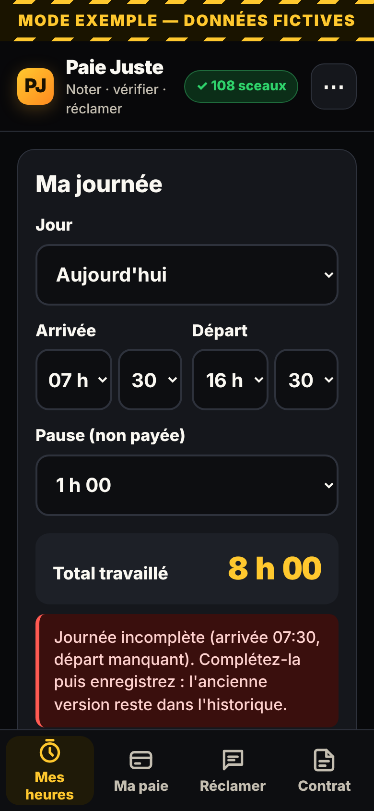
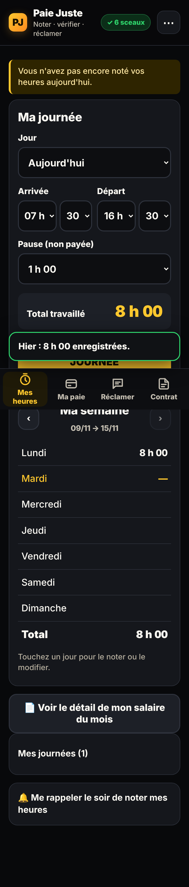
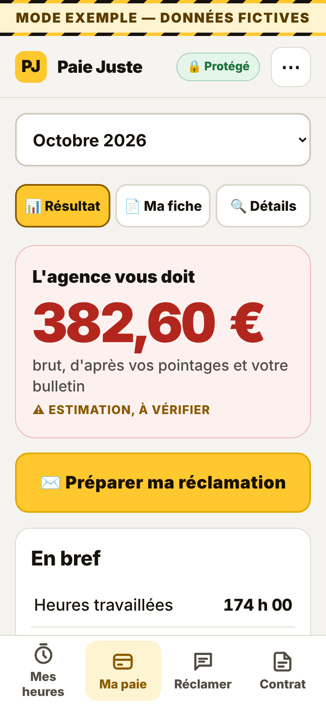

# Paie Juste

Paie Juste est une application installable, hors ligne, pour les salariés du privé (CDI, CDD, intérim, temps partiel).
Elle sert à noter ses heures, estimer la paie due selon le droit du travail français, la comparer au bulletin, et préparer une lettre de réclamation.
Chaque saisie est scellée dans une chaîne d'empreintes SHA-256. Pas de compte, pas de serveur.

**Application :** [https://haynbroit-alt.github.io/Paie-juste/](https://haynbroit-alt.github.io/Paie-juste/)

## Installer sur Android

1. Ouvrez le lien ci-dessus dans **Chrome**.
2. Menu Chrome (⋮) > **Ajouter à l'écran d'accueil**.
3. Lancez Paie Juste depuis l'icône. L'application s'ouvre ensuite sans connexion.

## Héberger sur Netlify (au lieu de GitHub Pages)

`netlify.toml` est prêt : pas d'étape de build, le dossier publié est la racine.
Sur [app.netlify.com](https://app.netlify.com) : **Add new project** > **Import an existing project** > **GitHub** > `Paie-juste`, puis **Deploy**. Chaque fusion sur `main` republie le site.

## Avertissement

Les montants sont une **estimation**, à vérifier. **Ce n'est pas un conseil juridique.** Une convention collective peut prévoir mieux que la loi.
Les pointages, le contrat et les bulletins **restent sur le téléphone**. Rien n'est envoyé à un serveur : un export ou une copie du courrier n'a lieu que si vous le demandez.

Les règles retenues, leurs sources et leurs limites sont dans [regles.md](regles.md). La correspondance avec les tests est dans [docs/REGLES-TESTS.md](docs/REGLES-TESTS.md).

## Aperçu

Captures du mode EXEMPLE, données fictives.








## Licence

[MIT](LICENSE). pdf.js et tesseract.js, dans `vendor/`, restent sous Apache-2.0.

## Tests

```bash
node tests/run.mjs
```

Tests dans Chrome headless, y compris quand l'application est servie sous un sous-chemin :

```bash
npm ci
python3 -m http.server 8781
node tests/browser.mjs http://127.0.0.1:8781/
```
