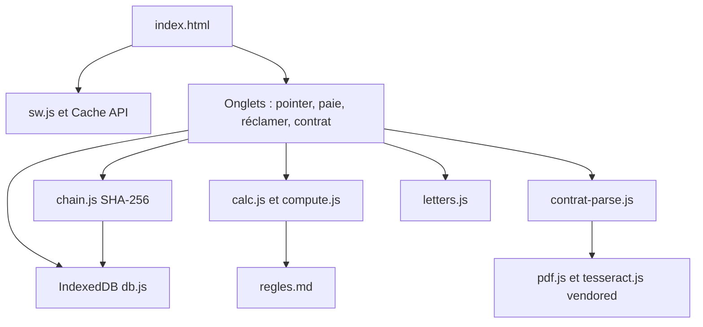

# Architecture

Paie Juste est une page statique. Il n'y a pas d'étape de build : `index.html`, `js/`, `css/`, `sw.js` et `vendor/` sont servis tels quels. Sur GitHub Pages, l'adresse est `https://haynbroit-alt.github.io/Paie-juste/` ; les chemins du manifeste et du service worker sont relatifs à ce dossier.

## Modules

| Fichier               | Rôle                                                                 |
| --------------------- | -------------------------------------------------------------------- |
| `js/calc.js`          | Règles pures : tranches d'heures, brut, net, comparaison au bulletin |
| `js/compute.js`       | Assemble une période à partir des pointages                          |
| `js/contrat-parse.js` | Propose des champs depuis un texte de contrat                        |
| `js/chain.js`         | Empreinte de chaque enregistrement                                   |
| `js/db.js`            | Journal append-only dans IndexedDB                                   |
| `js/letters.js`       | Brouillons de courrier, rien n'est envoyé                            |
| `sw.js`               | Cache versionné pour l'usage hors ligne                              |

Les calculs de paie ne dépendent pas du DOM. `node tests/run.mjs` les exerce. La correspondance avec les articles est dans [REGLES-TESTS.md](REGLES-TESTS.md).

## Types

`tsc --noEmit` vérifie `js/calc.js`, `js/compute.js`, `js/contrat-parse.js`, `js/chain.js` et `js/util.js` (`// @ts-check`, `strict`). L'interface, faite de gabarits HTML, n'est pas dans cette passe : la modifier pour le typage ne change pas les montants, et elle reste couverte par ESLint et les tests navigateur.
